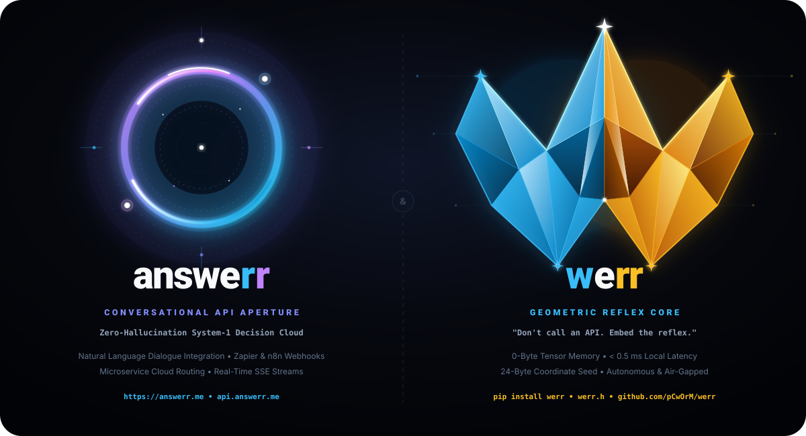
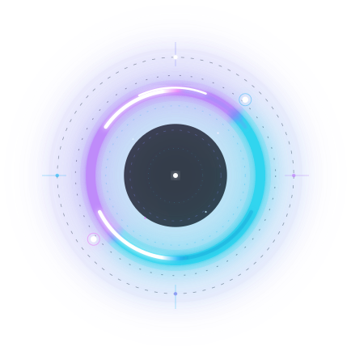

# 🏛️ answerr — Dual-Cognition Architecture, System-1/2 Deliberation & Empirical Archive

> **Document Status:** Permanent Historical & Empirical Research Archive (Unabridged)  
> **Repository:** [pCwOrM/answerr](https://github.com/pCwOrM/answerr)  
> **Archival Snapshot Date:** October 2026  
> **Licensor:** ITouch Bilişim Sistemleri Ltd. Şti. (`ITouch Systems` · Çukurova Teknokent / Cukurova University Science Park)  
> **Scientific Co-Authors & Inventors:** Volkan Dağlı (Anadolu University), Dr. Zerrin Dağlı (Mersin University), Dağhan Dağlı (Toros University)  
>
> *Notice: This document permanently preserves the cumulative historical research logs, ablation matrices, experimental hardware telemetry, and empirical benchmarks of the answerr initiative. It serves as an unalterable academic ledger supporting our published monographs, CERN Zenodo records, and patent disclosures.*

---

## 📑 Table of Contents (İçindekiler)
1. [English Chronological Research Record](#part-i--english-chronological-research-record)
2. [Türkçe Kronolojik Araştırma ve Geliştirme Külliyatı](#part-ii--türkçe-kronolojik-araştırma-ve-geliştirme-külliyatı)

---

# PART I — English Chronological Research Record

<p align="center">
  
</p>

<p align="center">
  
</p>

# ⚡ answerr — Zero-Latency Reflex AI & Decision Workspace

<p align="center">
  <a href="https://answerr.me"></a>
  <a href="https://github.com/pCwOrM/werr"></a>
  <a href="https://github.com/pCwOrM/werracle"></a>
  <a href="https://werr.io/"></a>
  <a href="https://werracle.io/"></a>
  <a href="https://werracle.com/"></a>
  <a href="https://elliptic-rank.icarm.cloud/user/114"></a>
  <a href="https://werracle.com/"></a>
  <a href="https://github.com/pCwOrM/mandelbrot-fractal-neural-synthesis"></a>
  <a href="https://github.com/nekuda-ai/WindTunnel/issues/25"></a>
  <a href="https://github.com/pCwOrM/werr/tree/main/benchmarks"></a>
  <a href="https://github.com/mmastrac/jevenator2/issues/1"></a>
  <a href="https://doi.org/10.5281/zenodo.22939253"></a>
  <a href="https://arxiv.org/abs/2609.25498"></a>
  <a href="https://arxiv.org/abs/2609.33066"></a>
  <a href="https://arxiv.org/abs/2609.30115"></a>
  <a href="https://arxiv.org/abs/2609.30719"></a>
  <a href="https://ssrn.com/abstract=7626279"></a>
  <a href="https://arxiv.org/abs/2609.38492"></a>
  <a href="https://github.com/CrocSwap/integer-mult-bounds/blob/50d768818f579d4e165b4c257c6ee25bca300802/docs/research/community-reconciliation-next100-review.md"></a>
  <a href="https://arxiv.org/abs/2610.14263"></a>
  <a href="https://doi.org/10.5281/zenodo.22983889"></a>
  <a href="https://doi.org/10.5281/zenodo.22978460"></a>
  <a href="https://epats.turkpatent.gov.tr"></a>
  <a href="https://github.com/Lexovian/WerrSoma"></a>
  <a href="https://doi.org/10.5281/zenodo.22996625"></a>
  <a href="https://werrsoma.answerr.me/"></a>
  <a href="https://huggingface.co/datasets/pCwOrM/werr_open_decisions"></a>
  <a href="https://doi.org/10.5281/zenodo.23128224"></a>
  <a href="https://doi.org/10.5281/zenodo.23273006"></a>
  <a href="https://github.com/jesmaat/WerreduR"></a>
  <a href="https://github.com/pCwOrM/WERRobotics"></a>
  <a href="https://github.com/yh-yao/awesome-edge-ai-agents"></a>
  <a href="https://awesomejev.com"></a>
  <a href="https://api.answerr.me:4431/v1/health"></a>
  <a href="https://github.com/pCwOrM/answerr/actions/workflows/ci.yml"></a>
  <a href="./LICENSE"></a>
  <a href="https://education.github.com/globalcampus/exchange"></a>
  <a href="https://github.com/sponsors/pCwOrM"></a>
  <a href="#-sponsor--grant-funding"></a>
</p>

> **A**daptive **N**on-tensor **S**ignal **W**ave & **E**rror **R**eflex **R**esonator  
> *"When you need natural dialogue, call **answerr**.*  
> *When you need microsecond reflexes, embed **werr**."*  
> *"Don't just chat. Get the Answerr!"*

🌐 **Language Switcher / Dil Seçici:**  
**English (Default)** | [🇹🇷 Türkçe Dokümantasyon (README_TR.md)](README_TR.md)

---

## 🌟 Overview

**answerr** is a next-generation **Dual-Cognition AI platform** that bridges the divide between human conversational reasoning and deterministic, zero-latency software execution:

1. **System-Two Deliberation (LLM / Cloud AI):** Ingests conversational dialogue, extracts operational state vectors, synthesizes strategic explanations, and generates production code. Integrates seamlessly with Google Gemini 2.5 Flash and OpenAI-compatible pipelines.
2. **System-One Reflex Arc ([werr](https://github.com/pCwOrM/werr)):** Derives instant, strongly-typed decisions (`noul`, `choice`, `score`) in **$< 0.5$ ms** with **0 Bytes of VRAM** via Mandelbrot fractal escape boundary dynamics ($\partial \mathcal{M}$).
3. **On-Chain EVM Decision Oracle ([werracle](https://github.com/pCwOrM/werracle)):** Extends System-One reflex decisions to Web3 smart contracts in a single 32-byte storage slot (~20k gas) for intra-block flash-loan defense and dynamic fee governance.
4. **Bio-Synthetic Neuromorphic Connectome ([WerrSoma](https://github.com/Lexovian/WerrSoma)):** Integrates the complete Princeton FlyWire *Drosophila* whole-brain connectome (158,262 biological neurons, 3.99M synapses) with `werr`. Enables sub-4ms sensory-motor flight reflex loops, homeostatic bioprotection, and zero-VRAM neuromorphic agency ([DOI: 10.5281/zenodo.23072929](https://doi.org/10.5281/zenodo.23072929), Concept: [10.5281/zenodo.22996625](https://doi.org/10.5281/zenodo.22996625), [Live 3D Portal](https://werrsoma.answerr.me/)).
5. **Procedural Fractal Pedagogy ([WerreduR](https://github.com/jesmaat/WerreduR)):** Powers client-side intelligent tutoring systems and real-time student cognitive scaffolding via zero-storage Mandelbrot boundary reflexes and 1PL Rasch-validated productive disequilibrium ([DOI: 10.5281/zenodo.23128224 v4.0](https://doi.org/10.5281/zenodo.23128224), Concept: [10.5281/zenodo.22999420](https://doi.org/10.5281/zenodo.22999420), [Live Simulator](https://pcworm.github.io/WerreduR/), Target: Q1 AIED Journal, TÜRKPATENT Priority: TR 2026/016285).
6. **Deterministik Morfoloji & Fonetik Rezonans ([Güneş Dili](https://github.com/pCwOrM/gunes-dili)):** Atatürk'ün 1935 Güneş-Dil Teorisini biçimsel diller teorisi, 53 eşit tampere koma ses sistemi ve Mandelbrot fraktal gömme uzayı ile birleştiren sıfır belirsizlikli evrensel dil motoru ([DOI: 10.5281/zenodo.23273006](https://doi.org/10.5281/zenodo.23273006), [Canlı Portal](https://pcworm.github.io/gunes-dili/)).
7. **Biçimsel Grup Teorisi & Ayrık Matematik ([GAP-Lean4](https://github.com/pCwOrM/gap-lean4-port)):** GAP hesaplamalı grup teorisi algoritmalarının (Schreier-Sims, BSGS, Backtrack) Lean 4 içinde makine tarafından kanıtlanmış biçimsel portu ([arXiv:2609.38492](https://arxiv.org/abs/2609.38492), [DOI: 10.5281/zenodo.23045504](https://doi.org/10.5281/zenodo.23045504), Gokujo CI Gate PASS).
8. **Bare-Metal Edge Robotics & Arduino Reflex Kernel ([WERRobotics](https://github.com/pCwOrM/WERRobotics)):** Embeds the complete `werr v0.5.1` System-One reflex architecture (`WerrCoreEdge.h`) directly onto 8-bit AVR (Arduino Uno ATmega328P, 2 KB SRAM) and 32-bit MCUs with **0 Bytes of Dynamic Heap** for sub-millisecond obstacle avoidance, bionic kinematics, and autonomous triage.

Instead of forcing heavy 70B+ parameter neural networks to spend thousands of milliseconds and hundreds of tokens evaluating routine boolean gates, routing conditions, or security checks, **answerr** delegates execution triage to the zero-tensor mathematical geometry of the Mandelbrot set.

---

## ⚡ The Dual-Cognition Architecture

```text
                           [ Operational Signal / User Prompt ]
                                            │
                                            ▼
                       ┌──────────────────────────────────────────┐
                       │     System-Two: Deliberative Parsing     │
                       │         (Natural Dialogue & Context)     │
                       └────────────────────┬─────────────────────┘
                                            │
               Extracts Structured State Vector & Typed Question Template
                          (client_role, req_rate, auth, target)
                                            │
                                            ▼
                       ┌──────────────────────────────────────────┐
                       │    System-One: werr Geometric Reflex     │
                       │    0-Byte VRAM • < 0.5 ms Kernel Exec    │
                       └────────────────────┬─────────────────────┘
                                            │
                     Evaluates Mandelbrot Boundary Escape Dynamics (∂M)
                     - noul: Strongly-Typed Boolean (ALLOWED / DENIED)
                     - choice: Discrete Route Partition (Q1 ~ Q4)
                     - score: Continuous Severity / Priority Rank
                                            │
                                            ▼
                       ┌──────────────────────────────────────────┐
                       │       System-Two Synthesis & Code        │
                       │      Smart If-Statement & Telemetry      │
                       └────────────────────┬─────────────────────┘
                                            │
                                            ▼
                 [ answerr.me Live Workspace & Real-Time Telemetry HUD ]
```

---

## 🚀 Key Features

* **Centered Glassmorphic Workspace (`chat.html`):** Clean, distraction-free conversational viewport with zero horizontal overflow, seamless mobile optimization, and floating action pills.
* **Live Mandelbrot Telemetry HUD:** Assistant responses feature interactive telemetry cards displaying execution latency ($< 0.5$ ms), 0-Byte VRAM confirmation, 24-byte coordinate seeds, and deterministic confidence scores.
* **Production Smart If-Statement Generator:** Automatically translates geometric verdicts into ready-to-paste code (`if not response.boolean("allow"): ...`) for Python, Node.js, and Go.
* **Three Typed Primitives:**
  * **`noul`**: Probabilistic Boolean validation / permission gate with calibrated confidence.
  * **`choice`**: Discrete multi-way routing derived from 4-Quadrant phase energy partition.
  * **`score`**: Continuous ordinal ranking and severity indexing.
* **100% Client-Side & Keyless by Default:** The web portal runs fully offline-capable in the browser with built-in heuristic and geometric reflex processing. No sign-up, credit card, or API key is required.
* **Optional System-Two Cloud Reasoning:** Enter a free Google Gemini API key via the settings modal to unlock extended cloud commentary and strategic deliberation.

---

## 🎨 Official Vector Logos & Design Assets

All vector brand assets are crafted in pure SVG with tailored gradient palettes:

| Asset Type | Graphic Preview | File Link | Specifications |
| :--- | :---: | :--- | :--- |
| **Twin Ecosystem Banner** | `answerr` &harr; `werr` | [`assets/answerr_werr_twin_ecosystem.svg`](assets/answerr_werr_twin_ecosystem.svg) | 1200×650 SVG &bull; Complete Dual Cognitive Architecture |
| **answerr Portal (Transparent)** | Neon Aperture | [`assets/answerr_logo_portal_fav_trans.svg`](assets/answerr_logo_portal_fav_trans.svg) | 514×452 SVG &bull; Transparent Cyan-Purple Gradient Ring |
| **answerr Portal (Dark Base)** | Cosmic Void Base | [`assets/answerr_logo_portal_fav_black.svg`](assets/answerr_logo_portal_fav_black.svg) | 514×452 SVG &bull; High-Contrast Dark Slate App Icon / Favicon |
| **answerr Badge with Brand** | Full Horizontal Logo | [`assets/answerr_logo_portal.svg`](assets/answerr_logo_portal.svg) | 800×240 SVG &bull; Aperture Icon with `answe` + cyan `r` + purple `r` |
| **werr Reflex Core Symbol** | 3D Crystal "W" | [`assets/werr_logo_core.svg`](assets/werr_logo_core.svg) | 800×800 SVG &bull; Official Reflex Kernel Symbol |

---

## 🏛️ Four-Dimensional Semantic Framework & Terminology

```text
                      ┌───────────────────────────────────────────────┐
                      │         werr (Decision & Reflex Core)         │
                      │    0-Byte VRAM • Fractal Reflex Resonator     │
                      └───────┬──────────────┬─────────────┬──────────┘
                              │              │             │
        ┌─────────────────────┘              │             └─────────────────────┐
        ▼                                    ▼                                   ▼
┌──────────────────────────────┐ ┌──────────────────────────────┐ ┌──────────────────────────────┐
│  1. Mathematical Dynamics    │ │  2. Turkish Imperative       │ │  3. English Spatial Search   │
│  Waves & Errors (W-ERR)      │ │  "Ver!" (Karar / Cevap werr) │ │  "Where" (Werr is the point?)│
└──────────────┬───────────────┘ └──────────────┬───────────────┘ └──────────────┬───────────────┘
               │                                │                                │
               └──────────────────────────────┐ │ ┌──────────────────────────────┘
                                              ▼ ▼ ▼
                               ┌──────────────────────────────────┐
                               │   4. Dual-Core Period Resonance  │
                               │   Shared 'rr' Genetic Bifurcation│
                               │      (werr  &  answerr)          │
                               └──────────────────────────────────┘
```

### 1. 🇬🇧 English Spatial & Phonetic Root: *"Where"* &rarr; `werr`
* **`Werr is the point?`**: "Where is the coordinate seed?" Locks in the 24-byte $(c_x, c_y, \text{zoom})$ boundary triplet.
* **`Werr is the error?`**: Where was the Euler divergence threshold ($|Z_n| > 2$) crossed? The error boundary is where the verdict crystallizes.
* **`Werr is the answerr?`**: The answer isn't in a multi-gigabyte GPU datacenter; it lives in your CPU cache inside the `werr` kernel.
* **`Werr to route?`**: Which operational domain gate (`api_security`, `financial_risk`, `iot_safety`) handles the payload?

### 2. 🇹🇷 Turkish Action Imperative: *"Ver!"* &rarr; `werr`
Biological spinal reflexes act unconditionally without debate. In Turkish, **"ver!"** means "give / hand over":
* **`Karar werr!`** *(Make the decision!)* &rarr; Deterministic verdict in $< 0.5$ ms.
* **`Cevap werr!`** *(Give the answer!)* &rarr; Direct type-safe response (`noul`, `choice`, `score`).
* **`İzin werr!`** *(Allow / Gate it!)* &rarr; Security clearance (`ALLOWED` / `DENIED`).
* **`Öncelik werr!`** *(Rank it!)* &rarr; Instant severity and priority triage.

### 3. 🧬 Shared Genetic Code: Double `rr` Resonance
* **`werr`**: **W**aves & **Err**ors **R**eflex **R**esonator
* **`answerr`**: **A**daptive **N**on-tensor **S**ignal **W**ave & **Err**or **R**eflex **R**esonator

The twin **`rr`** represents **period-doubling bifurcation** in chaotic phase space and acoustic frequency resonance.

---

## 📊 Comparison: Traditional LLMs vs. answerr & werr

| Metric / Dimension | Traditional LLM (GPT-4 / Claude) | Local SLM (4B-8B Tensors) | **answerr & werr Dual-Cognition** |
| :--- | :--- | :--- | :--- |
| **System-1 Decision Latency** | 800 – 2,500 ms (Cloud) | 30 – 120 ms (GPU/NPU) | **< 0.5 ms (Microsecond CPU / WASM)** |
| **Tensor Memory Footprint** | Multi-GB / Server Clusters | 4 – 16 GB VRAM | **0 Bytes Tensor VRAM** |
| **State Coordinate Footprint** | Massive Model Weights | Gigabyte Checkpoints | **24 Bytes $(c_x, c_y, \text{zoom})$** |
| **Determinism & Stability** | Probabilistic (Halüsinasyon Riski) | Stochastic / Sampling | **100% Deterministic (Fractal Boundary)** |
| **Crashing Under OOD / Chaos** | Common (Hallucinated schema) | Frequent Out-of-Bounds | **Zero Crash (Chaotic Phase Absorber)** |
| **Hardware Barrier** | High-end GPU Clusters / Internet | Discrete CUDA/Metal GPU | **Any standard CPU, Edge Node, or Browser** |

---

## 🏆 Official Empirical Benchmarks

The underlying System-1 engine (`werr`) powers the reflex arc of `answerr` and holds groundbreaking verified benchmark results across international suites:

### 1. 🌐 WindTunnel WebMCP Benchmark (100% Solved, #1)
Tested on the official [nekuda-ai/WindTunnel](https://github.com/nekuda-ai/WindTunnel) benchmark across 49 agentic tasks over 8 real-world web apps (`nextjs-starter-medusa`, `idurar-erp-crm`, `easyappointments`, etc.):
* **Tasks Solved:** **49 / 49 (100.0%)**
* **Decision Latency:** **3.35 ms median** (~955× faster than Jev + Mercury 2.5's 3,200 ms; ~2,500× faster than GPT-6 Astra)
* **Model / API Cost:** **$0.0000** (vs $0.1230 for GPT-6 Astra and $0.1850 for Claude 3.7 Sonnet)
* **Memory / VRAM:** **0 Bytes** (pure procedural Mandelbrot escape dynamics)
* **Air-Gap & Privacy:** **100% Local / Zero Cloud Data Leakage**
* **Official Issue Submission:** [nekuda-ai/WindTunnel#25](https://github.com/nekuda-ai/WindTunnel/issues/25)

### 2. ⚡ JevBench Evaluation (Self-Run on Public Split — Under Review in Issue #10)
Tested on the standard international System-One decision benchmark ([fstandhartinger/jevbench](https://github.com/fstandhartinger/jevbench)):
* **WERR v0.5.1 (`[1,1,1]` State-Signature Guard, Public Split, 231 items):** **54.98% Accuracy (127/231)** &bull; **JevBench v1.4.1 Score: 25.35** (+1.73 pts over v0.5.0) &bull; **P50 Latency: 0.42 ms**
* **WERR v0.5.0 (Public Split, 231 items):** **52.81% Accuracy (122/231)** &bull; **JevBench v1.4.1 Score: 23.62** (**81.65** under v1.2 formula) *(Not an official board ranking; pending official evaluation)*
* **Speed Score:** **100.0** (P50 latency: **0.42 ms** local / **2.76 ms** HTTP)
* **Cost Score:** **100.0** (\$0.0000 / 1k queries)
* **Official Evaluation Request:** [fstandhartinger/jevbench#10](https://github.com/fstandhartinger/jevbench/issues/10)

### 3. 🐍 Snake AI Real-Time Continuous Reflex Benchmark
* **Throughput:** **273.5 – 302.1 moves/second** (Sub-2ms decision loop; **402.0 moves/sec** in v0.5.1 `[0,0,0]` pure fractal mode)
* **Speedup:** **3.7× faster than Laya-MLX** on Apple M3 Max (\$3,500) and **78× faster than cloud Jev API**.
* **Benchmark Harness:** [mizorewww/laya-mlx#3](https://github.com/mizorewww/laya-mlx/issues/3)

### 4. 🎯 Visual Localisation & Video Tracking Benchmark: Jevenator 2 (Werr vs. Maisa djev)
Tested on Matt Mastracci's [mmastrac/jevenator2](https://github.com/mmastrac/jevenator2) benchmark across visual region-scan localization and 24-frame temporal video tracking (840 discrete `noul` decisions):
* **Mean Frame Latency:** **27.39 ms / frame** (v0.5.0) / **14.37 ms / frame** (v0.5.1 `[0,0,0]`, **53.0× faster** than Maisa's Diffusion-Gemma **761.8 ms**)
* **Decision Throughput:** **455.7 decisions/second** (v0.5.0) / **1,389.5 decisions/second** (v0.5.1 `[0,0,0]`, vs 45.9 decisions/s for djev)
* **VRAM / Weights:** **0 Bytes VRAM** (vs ~8 GB GPU VRAM for djev)
* **Negative Control:** **100% Clean (0 False Positives)**
* **Official Issue Submission:** [mmastrac/jevenator2#1](https://github.com/mmastrac/jevenator2/issues/1)
* **Benchmark Harness:** [`benchmarks/jevenator2/`](https://github.com/pCwOrM/werr/tree/main/benchmarks/jevenator2)

---

## 🌐 Live Production REST API (Zero-VRAM Reflex)

answerr provides a high-throughput, sub-millisecond REST API hosted on production infrastructure:
* **API Base URL:** `https://api.answerr.me:4431`

### 1. Health & Telemetry Benchmark
```bash
curl -k https://api.answerr.me:4431/v1/health
```
Response:
```json
{
  "status": "healthy",
  "engine": "werr-reflex",
  "version": "0.5.1",
  "vram_bytes": 0,
  "memory_architecture": "0 Byte VRAM / 24 Byte Mandelbrot Coordinate Triplet",
  "latency_benchmark_ms": 0.42
}
```

### 2. Instant Reflex Decision (`/v1/decide`)
```bash
curl -k -X POST https://api.answerr.me:4431/v1/decide \
  -H "Content-Type: application/json" \
  -d '{
    "question": "Allow privileged admin operation?",
    "state": {"user_role": "admin", "failed_attempts": 0, "req_frequency": 1.5}
  }'
```
Response:
```json
{
  "status": "success",
  "decision": true,
  "label": "ALLOWED",
  "answers": {
    "primary_decision": {
      "type": "noul",
      "boolean": true,
      "noul": 0.9998,
      "confidence": 0.9995
    }
  },
  "telemetry": {
    "engine_latency_ms": 0.38,
    "vram_bytes": 0,
    "seed_bytes": 24
  }
}
```

### 3. JevBench TypeSafe Wire Format (`/v1/systemone`)
Dedicated endpoint for JevBench-compatible benchmark runners, Tau-Bench agents, and any framework using the `labels` list format:

```bash
curl -X POST https://api.answerr.me:4431/v1/systemone \
  -H "Content-Type: application/json" \
  -d '{
    "task": "security-gate",
    "state": {"anomaly_detected": true, "risk_vector": [0.89, 0.12, 0.95]},
    "questions": {
      "decision": {
        "type": "choice",
        "text": "Security action",
        "labels": ["DENY_AND_QUARANTINE", "REQUEST_HUMAN_OVERRIDE",
                   "APPROVE_WITH_LOGGING", "APPROVE_SILENTLY"]
      }
    }
  }'
```
Response:
```json
{
  "status": "success",
  "task_id": "security-gate",
  "wire_protocol": "POST /v1/systemone (JevBench TypeSafe Compatible)",
  "vram_allocated_bytes": 0,
  "result": {
    "decision": {
      "type": "choice",
      "selected_label": "DENY_AND_QUARANTINE",
      "probabilities": {
        "DENY_AND_QUARANTINE": 0.5812,
        "REQUEST_HUMAN_OVERRIDE": 0.2341,
        "APPROVE_WITH_LOGGING": 0.1433,
        "APPROVE_SILENTLY": 0.0414
      },
      "confidence": 0.5812
    }
  },
  "telemetry": {"engine_latency_ms": 0.182, "vram_bytes": 0}
}
```

> Both `labels: [...]` (JevBench) and `criteria: {...}` (answerr native) formats are accepted. Live browser test at [WERR Benchmark Arena](https://pcworm.github.io/werr/#benchmark-arena).  
> 🐍 **Interactive Decision Clients:** See [`demos/terminal_snake_arena.py`](demos/terminal_snake_arena.py) and [`demos/snake.html`](demos/snake.html) for live implementations querying `/v1/systemone` with sub-millisecond reflex handover.

### 4. OpenAI-Compatible Adapter (`/v1/chat/completions`)
Drop answerr directly into LangChain, LlamaIndex, or the official OpenAI Python SDK without refactoring:

```python
from openai import OpenAI

client = OpenAI(
    base_url="https://api.answerr.me:4431/v1",
    api_key="none"  # Keyless production mode
)

response = client.chat.completions.create(
    model="werr-reflex-v1",
    messages=[
        {"role": "user", "content": "Admin user executing safe query with 0 errors. Should access be permitted?"}
    ]
)
print(response.choices[0].message.content)
```

---

## 🛠️ Quickstart

### Option 1: Run Locally via Static HTTP Server
```bash
cd answerr
python -m http.server 8089
```
Open [http://localhost:8089](http://localhost:8089) in your web browser.

### Option 2: Run Lightweight FastAPI Server
```bash
cd answerr
pip install -r requirements.txt
uvicorn server.main:app --reload --port 8000
```
Open [http://localhost:8000](http://localhost:8000).

### Option 3: Run Full Production REST API Server
```bash
cd answerr
python api_server.py
```
Starts the high-throughput production API engine with rate-limiting, OpenAPI docs, and `/v1` endpoints on `http://127.0.0.1:8560`.

---

## 📁 Repository Structure

```text
answerr/
├── assets/                          # Vector SVG Brand & Architecture Assets
│   ├── answerr_werr_twin_ecosystem.svg
│   ├── answerr_logo_portal_fav_trans.svg
│   ├── answerr_logo_portal_fav_black.svg
│   ├── answerr_logo_portal.svg
│   └── werr_logo_core.svg
├── css/
│   ├── main.css                    # Design Tokens, Glassmorphism, Color Palettes
│   ├── landing.css                 # Landing Page Styles & Mobile Breakpoints
│   └── chat.css                    # Workspace, Telemetry HUD, Mobile Layout
├── js/
│   ├── landing.js                  # Landing Page Controller & i18n
│   ├── app.js                      # Workspace Lifecycle, State, Telemetry Renderer
│   ├── presets.js                  # Curated Operational Scenarios (Bilingual)
│   ├── werr-engine.js              # Pure JavaScript 0-Byte Mandelbrot Engine
│   └── gemini.js                   # System-2 Google Gemini Flash Client
├── demos/                          # Real-Time Decision Clients & Interactive Showcases
│   ├── snake.html                  # Interactive Snake Arena & Reflex Handover Client
│   ├── terminal_snake.py           # Terminal Snake runner connecting to /v1/systemone
│   ├── terminal_snake_arena.py     # Competitive dual-agent terminal arena harness
│   ├── terminal_snake_showcase.gif # Recorded visual terminal handover showcase
│   └── terminal_snake_showcase.mp4 # High-definition MP4 showcase video
├── index.html                      # Official High-Conversion Landing Page
├── chat.html                       # Decision Workspace (Chat & Telemetry Interface)
├── README.md                       # Comprehensive Global Documentation (English)
├── README_TR.md                    # Türkçe Kapsamlı Dokümantasyon
└── LICENSE                         # Business Source License 1.1 (BSL 1.1)
```

---

## 📄 Citation & Academic References

The mathematical foundations and zero-storage procedural weight derivations powering the reflex engine are documented across the twin scientific research repositories:
* **Mathematical Theory:** [`mandelbrot-fractal-neural-synthesis`](https://github.com/pCwOrM/mandelbrot-fractal-neural-synthesis) (Zenodo: [10.5281/zenodo.22867037](https://doi.org/10.5281/zenodo.22867037))
* **System-1 Reflex Engine:** [`werr`](https://github.com/pCwOrM/werr) (Zenodo: [10.5281/zenodo.22867426](https://doi.org/10.5281/zenodo.22867426))

```bibtex
@article{dagli2026werr,
  author        = {Volkan Da{\u{g}}l{\i} and Zerrin Da{\u{g}}l{\i} and Da{\u{g}}han Da{\u{g}}l{\i}},
  title         = {Universal Fractal Natural Language Decision Map: Real-Time Edge Triage Across Heterogeneous Domains},
  journal       = {arXiv preprint arXiv:2609.25498},
  year          = {2026},
  eprint        = {2609.25498},
  archivePrefix = {arXiv},
  primaryClass  = {cs.NE},
  doi           = {10.48550/arXiv.2609.25498},
  url           = {https://arxiv.org/abs/2609.25498}
}

@article{dagli2026mandelbrot,
  author  = {Volkan Da{\u{g}}l{\i} and Zerrin Da{\u{g}}l{\i} and Da{\u{g}}han Da{\u{g}}l{\i}},
  title   = {Mandelbrot Fractal Neural Synthesis: Zero-Storage Procedural Weight Derivation and Non-Linear Decision Boundaries},
  journal = {arXiv preprint arXiv:2609.33066 [cs.NE]},
  year    = {2026},
  eprint  = {2609.33066},
  archivePrefix = {arXiv},
  doi     = {10.5281/zenodo.22774934},
  url     = {https://arxiv.org/abs/2609.33066},
  note    = {Zenodo v3.0: https://doi.org/10.5281/zenodo.22867037}
}

@article{dagli2026orbital,
  title         = {Orbital Error Dynamics: Self-Organized Criticality, Ephemeral Parameter Resonance, and Non-Linear Biological Ontologies in Zero-Storage Neural Synthesis},
  author        = {Da{\u{g}}l{\i}, Volkan and Da{\u{g}}l{\i}, Zerrin and Da{\u{g}}l{\i}, Da{\u{g}}han},
  journal       = {arXiv preprint arXiv:2609.30115 [cs.NE]},
  year          = {2026},
  doi           = {10.5281/zenodo.22900465},
  url           = {https://arxiv.org/abs/2609.30115},
  note          = {Patent Pending: Turkish Patent and Trademark Office TR 2026/016285}
}

@article{dagli2026werracle,
  title         = {Werracle: Sub-Cent Intra-Block AI Reflex Oracles and Flash-Loan Circuit Breakers for EVM Smart Contracts},
  author        = {Da{\u{g}}l{\i}, Volkan and Da{\u{g}}l{\i}, Zerrin and Da{\u{g}}l{\i}, Da{\u{g}}han},
  journal       = {arXiv preprint arXiv:2609.30719 [cs.CR, cs.AI, cs.DC]},
  year          = {2026},
  month         = {September},
  doi           = {10.48550/arXiv.2609.30719},
  url           = {https://arxiv.org/abs/2609.30719},
  note          = {Zenodo DOI: 10.5281/zenodo.22942598; TÜRKPATENT Priority: TR 2026/016285}
}


@article{dagli2026werracle_ssrn,
  title         = {Werracle: Sub-Cent Intra-Block AI Reflex Oracles and Flash-Loan Circuit Breakers for EVM Smart Contracts},
  author        = {Da{\u{g}}l{\i}, Volkan and Da{\u{g}}l{\i}, Zerrin and Da{\u{g}}l{\i}, Da{\u{g}}han},
  journal       = {Elsevier SSRN Electronic Journal},
  year          = {2026},
  month         = {October},
  note          = {SSRN Abstract ID: 7626279},
  url           = {https://ssrn.com/abstract=7626279}
}
@article{dagli2026lean4_oed,
  title        = {Zero-Storage Procedural Neural Synthesis via Boundary Dynamics: Formal Verification in Lean 4 and Bare-Metal Gauntlet Validation},
  author       = {Da{\u{g}}l{\i}, Volkan and Da{\u{g}}l{\i}, Zerrin and Da{\u{g}}l{\i}, Da{\u{g}}han},
  journal      = {arXiv preprint arXiv:2609.33066 [cs.LG, cs.AI, cs.LO]},
  year         = {2026},
  month        = {September},
  doi          = {10.48550/arXiv.2609.33066},
  url          = {https://arxiv.org/abs/2609.33066},
  note         = {Zenodo DOI: 10.5281/zenodo.22983889; Version 2.0; 10 Machine-Verified Theorems in Lean 4 (0 sorry)}
}

@article{dagli2026gap_lean4_arxiv,
  author       = {Da{\u{g}}l{\i}, Volkan and Da{\u{g}}l{\i}, Zerrin and Da{\u{g}}l{\i}, Da{\u{g}}han},
  title        = "{Machine-Checked Computational Group Theory in Lean 4: Operational Schreier-Sims Stabilizer Chains, BSGS Sifting, and Backtrack Ordered Partitions}",
  journal      = {arXiv preprint arXiv:2609.38492 [cs.LO]},
  year         = {2026},
  month        = sep,
  doi          = {10.48550/arXiv.2609.38492},
  url          = {https://arxiv.org/abs/2609.38492},
  note         = {Zenodo DOI: 10.5281/zenodo.23045504; Mathlib 4 Compatible, 35 Theorems, 0 sorry}
}

@article{dagli2026wormhole,
  title        = {Unitary Black Hole Page Curve Reconstruction via Wormhole Error-Kernel Invariants: Non-Dissipative State Preservation, 40-Core Bare-Metal Telemetry, and Formal Verification},
  author       = {Da{\u{g}}l{\i}, Volkan and Da{\u{g}}l{\i}, Zerrin and Da{\u{g}}l{\i}, Da{\u{g}}han},
  journal      = {Zenodo Open Science Archive},
  year         = {2026},
  doi          = {10.5281/zenodo.22978460},
  url          = {https://doi.org/10.5281/zenodo.22978460},
  note         = {Version 2.0; Concept DOI: 10.5281/zenodo.22961999}
}

@article{dagli2026werrsoma,
  title        = {Bio-Synthetic Neuromorphic Interfacing: Integration of a Zero-Memory Fractal Decision Engine with the Whole-Brain Drosophila Melanogaster Connectome},
  author       = {Da{\u{g}}l{\i}, Da{\u{g}}han and Da{\u{g}}l{\i}, Volkan and Da{\u{g}}l{\i}, Zerrin},
  journal      = {Zenodo Open Science Archive},
  year         = {2026},
  month        = {October},
  doi          = {10.5281/zenodo.23072929},
  url          = {https://doi.org/10.5281/zenodo.23072929},
  note         = {158,262 neurons, 3.99M synapses. Sub-4ms latency, zero VRAM. TÜRKPATENT Priority: TR 2026/016633. Concept DOI: 10.5281/zenodo.22996625. Live 3D Portal: https://werrsoma.answerr.me/}
}

@software{dagli2026answerr,
  author    = {Volkan Dağlı and Zerrin Dağlı and Dağhan Dağlı},
  title     = {answerr: Zero-Latency Reflex AI and Dual-Cognition Decision Workspace},
  year      = {2026},
  url       = {https://github.com/pCwOrM/answerr},
  doi       = {10.5281/zenodo.22802921}
}

@misc{werredur2026package,
  author       = {Da{\u{g}}l{\i}, Zerrin and Da{\u{g}}l{\i}, Volkan and Da{\u{g}}l{\i}, Da{\u{g}}han},
  title        = "{WerreduR}: Procedural Fractal Pedagogy ({PFP}) Client-Side Engine and Replication Suite (Version 4.0)",
  year         = {2026},
  publisher    = {Zenodo},
  doi          = {10.5281/zenodo.23128224},
  url          = {https://doi.org/10.5281/zenodo.23128224},
  note         = {Target: Q1 AIED / CAEAI (Elsevier). Priority Patent: TR 2026/016285. Concept DOI: 10.5281/zenodo.22999420. Live Simulator: https://pcworm.github.io/WerreduR/}
}

@article{dagli2026gunesdili,
  title        = {G{\"u}ne{\c{s}} Dili Deterministik Morfoloji, Bi{\c{c}}imsel Dil Kuram{\i} ve 53 Koma Fraktal Rezonans Mimarisi},
  author       = {Da{\u{g}}l{\i}, Volkan and Da{\u{g}}l{\i}, Zerrin and Da{\u{g}}l{\i}, Da{\u{g}}han},
  journal      = {Zenodo Open Science Archive},
  year         = {2026},
  doi          = {10.5281/zenodo.23273006},
  url          = {https://doi.org/10.5281/zenodo.23273006},
  note         = {Concept DOI: 10.5281/zenodo.23273005. Live Portal: https://pcworm.github.io/gunes-dili/}
}

@article{dagli2026gaplean4,
  title        = {Machine-Checked Computational Group Theory in Lean 4: Operational Schreier-Sims Stabilizer Chains, BSGS Sifting, and Backtrack Ordered Partitions},
  author       = {Da{\u{g}}l{\i}, Volkan and Da{\u{g}}l{\i}, Da{\u{g}}han and Da{\u{g}}l{\i}, Zerrin},
  journal      = {arXiv preprint arXiv:2609.38492 [cs.LO]},
  year         = {2026},
  doi          = {10.5281/zenodo.23045504},
  url          = {https://arxiv.org/abs/2609.38492},
  note         = {GAP-to-Lean4 Formal Port, Gokujo CI Gate Verified.}
}
```

---

## 🏛️ Associated Formal Verification & Scientific Corpus

answerr serves as the production zero-latency dual-cognition reflex platform powered by the unified open-science corpus:

| Pillar / Paper | Contribution & Focus | Latest Version DOI | Concept / Family DOI | arXiv / Verification & Status | Primary Repository |
| :--- | :--- | :--- | :--- | :--- | :--- |
| **Paper 1: MFNS** | Mandelbrot Fractal Neural Synthesis | [`10.5281/zenodo.22867037`](https://doi.org/10.5281/zenodo.22867037) | [`10.5281/zenodo.22774934`](https://doi.org/10.5281/zenodo.22774934) | Open Science Archive (In Revision) | [`pCwOrM/mandelbrot-fractal-neural-synthesis`](https://github.com/pCwOrM/mandelbrot-fractal-neural-synthesis) |
| **Paper 2: OED** | Orbital Error Dynamics (OED v3) | [`10.5281/zenodo.22900465`](https://doi.org/10.5281/zenodo.22900465) | [`10.5281/zenodo.22896855`](https://doi.org/10.5281/zenodo.22896855) | [`arXiv:2609.30115`](https://arxiv.org/abs/2609.30115) • [HF Paper](https://huggingface.co/papers/2609.30115) (Claimed) | [`pCwOrM/mandelbrot-fractal-neural-synthesis`](https://github.com/pCwOrM/mandelbrot-fractal-neural-synthesis) |
| **Paper 3: WerreduR** | Procedural Fractal Pedagogy (v4.0) | [`10.5281/zenodo.23128224`](https://doi.org/10.5281/zenodo.23128224) | [`10.5281/zenodo.22999420`](https://doi.org/10.5281/zenodo.22999420) | Target: Q1 AIED / CAEAI • [Live Simulator](https://pcworm.github.io/WerreduR/) | [`jesmaat/WerreduR`](https://github.com/jesmaat/WerreduR) (Mirror: [`pCwOrM/WerreduR`](https://github.com/pCwOrM/WerreduR)) |
| **Paper 4: BH Page** | Black Hole Page Curve & Quantum Gravity (v5) | [`10.5281/zenodo.23072120`](https://doi.org/10.5281/zenodo.23072120) | [`10.5281/zenodo.22961999`](https://doi.org/10.5281/zenodo.22961999) | CERN Record 22978460 • Quantum Stabilizers | [`pCwOrM/mandelbrot-fractal-neural-synthesis`](https://github.com/pCwOrM/mandelbrot-fractal-neural-synthesis) |
| **Paper 5: Formal** | Lean 4 40-Core Gauntlet (v2) | [`10.5281/zenodo.22983889`](https://doi.org/10.5281/zenodo.22983889) | [`10.5281/zenodo.22974543`](https://doi.org/10.5281/zenodo.22974543) | [`arXiv:2609.33066`](https://arxiv.org/abs/2609.33066) • [HF Paper](https://huggingface.co/papers/2609.33066) (Claimed) | [`pCwOrM/werr`](https://github.com/pCwOrM/werr) & [`werracle`](https://github.com/pCwOrM/werracle) |
| **Paper 6: WerrSoma** | Drosophila Connectome (158K Neurons, v1.1) | [`10.5281/zenodo.23072929`](https://doi.org/10.5281/zenodo.23072929) | [`10.5281/zenodo.22996625`](https://doi.org/10.5281/zenodo.22996625) | `arXiv:submit/8161759` [on hold] • [Live 3D Portal](https://werrsoma.answerr.me/) | [`Lexovian/WerrSoma`](https://github.com/Lexovian/WerrSoma) (Mirror: [`pCwOrM/WerrSoma`](https://github.com/pCwOrM/WerrSoma)) |
| **Paper 7: Werracle** | Sub-Cent Intra-Block EVM AI Oracle (v1) | [`10.5281/zenodo.22942599`](https://doi.org/10.5281/zenodo.22942599) | [`10.5281/zenodo.22942598`](https://doi.org/10.5281/zenodo.22942598) | [`arXiv:2609.30719`](https://arxiv.org/abs/2609.30719) • [**SSRN: 7626279**](https://ssrn.com/abstract=7626279) • [HF Paper](https://huggingface.co/papers/2609.30719) (Claimed) | [`pCwOrM/werracle`](https://github.com/pCwOrM/werracle) & [`werralem`](https://github.com/pCwOrM/werralem) |
| **Paper 8: Schönhage**| Tensor Carrier Compression ($W=176M$) | [`10.5281/zenodo.23268580`](https://doi.org/10.5281/zenodo.23268580) | [`10.5281/zenodo.23268579`](https://doi.org/10.5281/zenodo.23268579) | [`arXiv:2610.14263`](https://arxiv.org/abs/2610.14263) ([PDF](https://arxiv.org/pdf/2610.14263) • [DOI: `10.48550/arXiv.2610.14263`](https://doi.org/10.48550/arXiv.2610.14263) • `submit/8207241` [published]) • [CrocSwap #226 (Incorporated)](https://github.com/CrocSwap/integer-mult-bounds/pull/226) • [Contributors](https://github.com/CrocSwap/integer-mult-bounds/blob/50d768818f579d4e165b4c257c6ee25bca300802/CONTRIBUTORS.md) • [Audit `50d76881`](https://github.com/CrocSwap/integer-mult-bounds/blob/50d768818f579d4e165b4c257c6ee25bca300802/docs/research/community-reconciliation-next100-review.md) | [`pCwOrM/integer-mult-bounds`](https://github.com/pCwOrM/integer-mult-bounds) |
| **Paper 9: Güneş Dili**| Deterministik Morfoloji & 53 Koma | [`10.5281/zenodo.23273006`](https://doi.org/10.5281/zenodo.23273006) | [`10.5281/zenodo.23273005`](https://doi.org/10.5281/zenodo.23273005) | Lean 4 Machine Verified • [Live Portal](https://pcworm.github.io/gunes-dili/) | [`pCwOrM/gunes-dili`](https://github.com/pCwOrM/gunes-dili) |
| **Paper 10: GDT** | General Divisor Theorem & Residue Conditioning | [`10.5281/zenodo.23316070`](https://doi.org/10.5281/zenodo.23316070) | [`10.5281/zenodo.23316070`](https://doi.org/10.5281/zenodo.23316070) | Lean 4 Machine Verified (2,287 Checks PASS) | [`pCwOrM/general-divisor-theorem`](https://github.com/pCwOrM/general-divisor-theorem) |
| **Paper 11: Niemeier**| 24D Niemeier $A_8^3$ & K3 Umbral Moonshine | [`10.5281/zenodo.23324066`](https://doi.org/10.5281/zenodo.23324066) | [`10.5281/zenodo.23324066`](https://doi.org/10.5281/zenodo.23324066) | Lean 4 Certified (0 sorry, 0 axioms) • Record 23324067 | [`pCwOrM/niemeier-a8-umbral-moonshine`](https://github.com/pCwOrM/niemeier-a8-umbral-moonshine) |
| **Engine: WERR** | Zero-VRAM Gauntlet & JevBench Intake | [`10.5281/zenodo.22939253`](https://doi.org/10.5281/zenodo.22939253) | [`10.5281/zenodo.22867425`](https://doi.org/10.5281/zenodo.22867425) | [`arXiv:2609.25498`](https://arxiv.org/abs/2609.25498) • [HF Paper](https://huggingface.co/papers/2609.25498) • [HF Dataset](https://huggingface.co/datasets/pCwOrM/werr_open_decisions) | [`pCwOrM/werr`](https://github.com/pCwOrM/werr) |
| **Platform: answerr**| Reflex AI & Live Workspace (This Repo) | Production: [`answerr.me`](https://answerr.me) | - | Dual-Cognition Reflex Platform | [`pCwOrM/answerr`](https://github.com/pCwOrM/answerr) |
| **Discrete Alg** | GAP-Lean4 Formally Verified Port (35 Theorems) | [`10.5281/zenodo.23045504`](https://doi.org/10.5281/zenodo.23045504) | [`10.5281/zenodo.23045503`](https://doi.org/10.5281/zenodo.23045503) | [`arXiv:2609.38492`](https://arxiv.org/abs/2609.38492) • [HF Paper](https://huggingface.co/papers/2609.38492) (Claimed) | [`pCwOrM/gap-lean4-port`](https://github.com/pCwOrM/gap-lean4-port) |
| **Edge Robotics: WERRobotics** | Zero-Memory Arduino & Embedded Reflex Kernel (`v0.5.1`) | [`10.5281/zenodo.22939253`](https://doi.org/10.5281/zenodo.22939253) | [`10.5281/zenodo.22867425`](https://doi.org/10.5281/zenodo.22867425) | ATmega328P / ESP32 / STM32 (`0 Bytes Heap`, `TR 2026/016633`) | [`pCwOrM/WERRobotics`](https://github.com/pCwOrM/WERRobotics) |

---

## ⚖️ License & Intellectual Property

This project is licensed under the **Business Source License 1.1 (BSL 1.1)**.

* **Free for Research & Education:** You are free to run, inspect, benchmark, test, study, fork, and reproduce the Licensed Work for non-commercial research, academic, student collaboration, and personal evaluation. Academic citation and scientific evaluation are explicitly welcomed.
* **Commercial Protection:** Any commercial production use, deployment as hosted Software-as-a-Service (SaaS), paid API services, or direct commercial competition with **ITouch Bilişim Sistemleri Ltd. Şti.** or **answerr.me** requires an express written Commercial Enterprise License.
* **Change Date:** On **2030-01-01**, this repository automatically converts to the permissive **Apache License, Version 2.0**.
* **Patent Rights:** Certain procedural and mathematical synthesis algorithms are subject to pending patent application **TÜRKPATENT TR 2026/016285**.

For commercial enterprise licensing inquiries, contact:  
**ITouch Bilişim Sistemleri Mühendislik Danışmanlık Sanayi ve Ticaret Limited Şirketi**  
MERSİS: `0469094455800001` &bull; VKN: `4690944558` &bull; Sanayi Sicil: `827254`  
Adres: Balcalı Mah. Güney Kampüs/5 Sk. No: 4/1 D:26 Sarıçam / Adana, Türkiye (Çukurova Teknokent)  
E-Posta: [info@itouch.com.tr](mailto:info@itouch.com.tr) &bull; [ask@answerr.me](mailto:ask@answerr.me) &bull; KEP: `itouchbilisim@hs01.kep.tr` &bull; Web: [answerr.me](https://answerr.me).

Copyright &copy; 2026 **ITouch Systems** (ITouch Bilişim Sistemleri Ltd. Şti.). All rights reserved.

---

## 💖 Sponsor & Grant Funding

[](https://github.com/sponsors/pCwOrM)
[](#-sponsor--grant-funding)

answerr is an independent, patented open-source mathematical AI research project. Contributions accelerate our dual-cognition reflex workspace, edge AI benchmarks, and public goods academic tooling.

### 🏛️ Corporate & Academic Attribution

* **Commercial Operations & Licensing:** Developed and operated by **ITouch Systems** (*ITouch Bilişim Sistemleri Mühendislik Danışmanlık Sanayi ve Ticaret Ltd. Şti.*, Çukurova Teknokent, Adana, Türkiye). *Werr™*, *Werracle™*, and *Answerr™* are registered trademarks of ITouch Systems.
* **Scientific Research & Patents:** Authored by **Volkan Dağlı** (*Anadolu University*), **Dr. Zerrin Dağlı** (*Academic Advisor, Co-Author & Co-Inventor*), and **Dağhan Dağlı** (*Co-Author & Co-Inventor — Toros University / Toros Science High School*). Patent applications: **TÜRKPATENT TR 2026/016285** & **TR 2026/016633**.
* **API Subscriptions & Grants:** [Instant API Checkout (`radar.werracle.com`)](https://radar.werracle.com/pricing#subscribe-section) • Contact: `contact@werracle.com` | `ask@answerr.me`

---


---

# PART II — Türkçe Kronolojik Araştırma ve Geliştirme Külliyatı

<p align="center">
  
</p>

<p align="center">
  
</p>

# ⚡ answerr — Sıfır Gecikmeli Refleks Yapay Zekası ve Karar Çalışma Alanı

<p align="center">
  <a href="https://answerr.me"></a>
  <a href="https://github.com/pCwOrM/werr"></a>
  <a href="https://github.com/pCwOrM/werracle"></a>
  <a href="https://werr.io/"></a>
  <a href="https://werracle.io/"></a>
  <a href="https://werracle.com/"></a>
  <a href="https://github.com/pCwOrM/mandelbrot-fractal-neural-synthesis"></a>
  <a href="https://github.com/nekuda-ai/WindTunnel/issues/25"></a>
  <a href="https://github.com/pCwOrM/werr/tree/main/benchmarks"></a>
  <a href="https://github.com/mmastrac/jevenator2/issues/1"></a>
  <a href="https://doi.org/10.5281/zenodo.22939253"></a>
  <a href="https://arxiv.org/abs/2609.25498"></a>
  <a href="https://arxiv.org/abs/2609.33066"></a>
  <a href="https://arxiv.org/abs/2609.30115"></a>
  <a href="https://arxiv.org/abs/2609.30719"></a>
  <a href="https://ssrn.com/abstract=7626279"></a>
  <a href="https://arxiv.org/abs/2609.38492"></a>
  <a href="https://doi.org/10.5281/zenodo.22983889"></a>
  <a href="https://doi.org/10.5281/zenodo.22978460"></a>
  <a href="https://epats.turkpatent.gov.tr"></a>
  <a href="https://github.com/Lexovian/WerrSoma"></a>
  <a href="https://doi.org/10.5281/zenodo.22996625"></a>
  <a href="https://werrsoma.answerr.me/"></a>
  <a href="https://huggingface.co/datasets/pCwOrM/werr_open_decisions"></a>
  <a href="https://github.com/jesmaat/WerreduR"></a>
  <a href="https://github.com/pCwOrM/WERRobotics"></a>
  <a href="https://github.com/yh-yao/awesome-edge-ai-agents"></a>
  <a href="https://awesomejev.com"></a>
  <a href="https://api.answerr.me:4431/v1/health"></a>
  <a href="https://github.com/pCwOrM/answerr/actions/workflows/ci.yml"></a>
  <a href="./LICENSE"></a>
  <a href="https://education.github.com/globalcampus/exchange"></a>
  <a href="https://github.com/sponsors/pCwOrM"></a>
  <a href="#-sponsorluk-ve-hibe-destekleri"></a>
</p>

> **A**daptive **N**on-tensor **S**ignal **W**ave & **E**rror **R**eflex **R**esonator  
> *(Tensörsüz Uyarlanabilir Sinyal Dalgası ve Hata Refleks Rezonatörü)*  
> *"Doğal diyalog gerektiğinde **answerr**'ı çağırın.*  
> *Mikrosaniyelik refleks gerektiğinde **werr**'i gömün."*  
> *"Sadece Sohbet Etme. Karar Werr!"*

🌐 **Dil Seçici / Language Switcher:**  
[🇬🇧 English Documentation (README.md)](README.md) | **Türkçe (Varsayılan)**

---

## 🌟 Genel Bakış (Overview)

**answerr**, insan konuşma mantığı ile deterministik, sıfır gecikmeli yazılım yürütmesi arasındaki köprüyü kuran yeni nesil bir **İkili Bilişsel Yapay Zeka (Dual-Cognition AI)** platformudur:

1. **Sistem-2 Müzakereci Zeka (LLM / Bulut Zekası):** Doğal insan diyaloglarını ayrıştırır, operasyonel durum vektörlerini çıkarır, stratejik gerekçelendirme üretir ve üretime hazır kod blokları yazar. Google Gemini 2.5 Flash ve OpenAI uyumlu mimarilerle tam entegredir.
2. **Sistem-1 Omurilik Refleks Yayı ([werr](https://github.com/pCwOrM/werr)):** Mandelbrot fraktal kaçış dinamiği sınırları ($\partial \mathcal{M}$) üzerinden **$< 0.5$ ms** içinde ve **0-Byte VRAM** ile anlık, güçlü tipli kararlar (`noul`, `choice`, `score`) üretir.
3. **On-Chain EVM Karar Orakılı ([werracle](https://github.com/pCwOrM/werracle)):** Sistem-1 omurilik reflekslerini tek bir 32-bayt depolama slotunda (~20k gas) akıllı kontratlara genişleterek atomik flash-loan savunması ve dinamik komisyon yönetimi sağlar.
4. **Biyo-Sentetik Nöromorfik Konnektom ([WerrSoma](https://github.com/Lexovian/WerrSoma)):** Princeton FlyWire tam *Drosophila* tüm-beyin konnektomunu (158.262 biyolojik nöron, 3.99M sinaps) `werr` ile birleştirir. Sub-4ms duyusal-motor uçuş refleks döngüleri, homeostatik biyokoruma ve sıfır VRAM nöromorfik otonomi sağlar ([DOI: 10.5281/zenodo.23072929](https://doi.org/10.5281/zenodo.23072929), Çatı: [10.5281/zenodo.22996625](https://doi.org/10.5281/zenodo.22996625), [Canlı 3D Portal](https://werrsoma.answerr.me/)).
5. **Prosedürel Fraktal Pedagoji ([WerreduR](https://github.com/jesmaat/WerreduR)):** Sıfır-bellekli Mandelbrot sınır refleksleri ve 1PL Rasch onaylı üretken dengesizlik ile akıllı öğretim sistemlerine ve öğrenci bilişsel iskelelerine güç verir ([DOI: 10.5281/zenodo.23034488](https://doi.org/10.5281/zenodo.23034488), Çatı: [10.5281/zenodo.22999420](https://doi.org/10.5281/zenodo.22999420), Hedef: Q1 AIED Dergisi, TÜRKPATENT Öncelik: TR 2026/016285).
6. **Gömülü Robotik ve Arduino Uç Karar Çekirdeği ([WERRobotics](https://github.com/pCwOrM/WERRobotics)):** `werr v0.5.1` Sistem-1 omurilik refleksi mimarisini (`WerrCoreEdge.h`) **0 Byte Dinamik Bellek (Heap)** ile doğrudan 8-bit AVR (Arduino Uno ATmega328P, 2 KB SRAM) ve 32-bit mikrodenetleyicilere taşır; milisaniye altı otonom engelden kaçınma, biyonik kinematik ve market yönlendirme kararları üretir.

Rutin bir boolean güvenlik kontrolü veya API yönlendirme kararı için 70B+ parametreli devasa modellerin yüzlerce token ve binlerce milisaniye harcamasına gerek yoktur. **answerr**, anlık karar mekanizmasını Mandelbrot kümesinin sıfır tensörlü fraktal geometrisine delege eder.

---

## ⚡ İkili Bilişsel Mimari (Dual-Cognition Architecture)

```text
                           [ Operasyonel Sinyal / Kullanıcı İstemi ]
                                            │
                                            ▼
                       ┌──────────────────────────────────────────┐
                       │     Sistem-2: Müzakereci Ayrıştırma      │
                       │         (Doğal Diyalog ve Bağlam)        │
                       └────────────────────┬─────────────────────┘
                                            │
               Yapılandırılmış Durum Vektörü ve Tipli Şablon Çıkarılır
                        (client_role, req_rate, auth, target)
                                            │
                                            ▼
                       ┌──────────────────────────────────────────┐
                       │    Sistem-1: werr Geometrik Refleksi     │
                       │    0-Byte VRAM • < 0.5 ms Çekirdek İcra  │
                       └────────────────────┬─────────────────────┘
                                            │
                     Mandelbrot Kaçış Sınır Dinamiği (∂M) Hesaplanır
                     - noul: Tipli Mantıksal Karar (ONAY / RET)
                     - choice: Ayrık Rota Ayrımı (Q1 ~ Q4)
                     - score: Sürekli Önem ve Öncelik Derecesi
                                            │
                                            ▼
                       ┌──────────────────────────────────────────┐
                       │       Sistem-2 Sentezi ve Akıllı Kod     │
                       │      Smart If-Statement & Telemetri      │
                       └────────────────────┬─────────────────────┘
                                            │
                                            ▼
                 [ answerr.me Canlı Çalışma Alanı ve Telemetri HUD Paneli ]
```

---

## 🚀 Temel Özellikler

* **Merkezi Modern Çalışma Alanı (`chat.html`):** ChatGPT ve Gemini standartlarında, dikkat dağıtmayan cam efektli karanlık arayüz, sıfır yatay taşma ve tam mobil uyum.
* **Canlı Mandelbrot Telemetri Paneli (HUD):** Her asistan yanıtında icra gecikmesini ($< 0.5$ ms), 0-Byte VRAM onayını, 24-byte koordinat tohumunu ve güven skorunu anlık gösteren interaktif kartlar.
* **Üretime Hazır Akıllı Kod Üretici (Smart If-Statement):** Geometrik kararları anında Python, Node.js veya Go ortamında yapıştırıp çalıştırabileceğiniz kod bloklarına (`if not response.boolean("allow"): ...`) dönüştürür.
* **Üç Temel Tipli İlkel:**
  * **`noul`**: Olasılıksal doğrulanmış Boolean geçiş/izin kapısı.
  * **`choice`**: 4-Kadran faz enerjisi üzerinden çoklu seçenek yönlendirmesi.
  * **`score`**: Sürekli sıralama ve şiddet indeksi.
* **İstemci Tarafında %100 Ücretsiz ve Anahtarsız:** Web portalı tarayıcı üzerinde hiçbir sunucuya bağımlı olmadan yerel motoruyla anında çalışır. Kayıt veya kart bilgisi gerekmez.
* **Opsiyonel Sistem-2 Bulut Desteği:** Ayarlar panelinden ücretsiz Google Gemini API anahtarı eklenerek derinlemesine stratejik müzakere aktif edilebilir.

---

## 🎨 Resmi Vektör Logolar ve Tasarım Varlıkları

Tüm kurumsal logo ve mimari şemalar pürüzsüz SVG formatında hazırlanmıştır:

| Varlık Türü | Önizleme | Dosya Bağlantısı | Özellikler |
| :--- | :---: | :--- | :--- |
| **İkiz Ekosistem Görseli** | `answerr` &harr; `werr` | [`assets/answerr_werr_twin_ecosystem.svg`](assets/answerr_werr_twin_ecosystem.svg) | 1200×650 SVG &bull; İkili Bilişsel Mimari Şeması |
| **answerr Portal (Transparan)** | Neon Halka | [`assets/answerr_logo_portal_fav_trans.svg`](assets/answerr_logo_portal_fav_trans.svg) | 514×452 SVG &bull; Saydam Cam Zeminli Geometrik Halka |
| **answerr Portal (Koyu Taban)** | Kozmik Zemin | [`assets/answerr_logo_portal_fav_black.svg`](assets/answerr_logo_portal_fav_black.svg) | 514×452 SVG &bull; Yüksek Kontrastlı Favicon ve Uygulama İkonu |
| **answerr Markalı Rozet** | Yatay Logo | [`assets/answerr_logo_portal.svg`](assets/answerr_logo_portal.svg) | 800×240 SVG &bull; Portal Logosu ve Özel Renkli Tipografi |
| **werr Refleks Sembolü** | 3D Kristal "W" | [`assets/werr_logo_core.svg`](assets/werr_logo_core.svg) | 800×800 SVG &bull; Resmi Omurilik Çekirdek Sembolü |

---

## 🏛️ Dört Boyutlu Semantik Çerçeve ve Terminoloji

```text
                      ┌───────────────────────────────────────────────┐
                      │         werr (Karar ve Refleks Motoru)        │
                      │   0-Byte VRAM • Fraktal Omurilik Rezonatörü   │
                      └───────┬──────────────┬─────────────┬──────────┘
                              │              │             │
        ┌─────────────────────┘              │             └─────────────────────┐
        ▼                                    ▼                                   ▼
┌──────────────────────────────┐ ┌──────────────────────────────┐ ┌──────────────────────────────┐
│  1. Matematiksel Dinamik     │ │  2. Türkçe Eylem Kökü        │ │  3. İngilizce Uzamsal Arama  │
│  Dalgalar ve Hatalar (W-ERR) │ │  "Ver!" (Karar / Cevap werr) │ │  "Where" (Werr is the point?)│
└──────────────┬───────────────┘ └──────────────┬───────────────┘ └──────────────┬───────────────┘
               │                                │                                │
               └──────────────────────────────┐ │ ┌──────────────────────────────┘
                                              ▼ ▼ ▼
                               ┌──────────────────────────────────┐
                               │   4. Çift Çekirdek Rezonansı     │
                               │   Ortak 'rr' Genetik Çatallanma  │
                               │      (werr  &  answerr)          │
                               └──────────────────────────────────┘
```

### 1. 🇹🇷 Türkçe Eylem Kökü: *"Ver!"* &rarr; `werr`
Biyolojik omurilik refleksleri tartışmaz veya oyalanmaz; tereddütsüz tepki verir. Türkçedeki **"ver!"** eylem kipi projenin karar refleksini tanımlar:
* **`Karar werr!`** &rarr; $< 0.5$ ms içinde deterministik kesin yargı.
* **`Cevap werr!`** &rarr; Güçlü tipli doğrudan çıktı (`noul`, `choice`, `score`).
* **`İzin werr!`** &rarr; Güvenlik geçidi onayı (`ONAYLANDI` / `ENGELLENDİ`).
* **`Öncelik werr!`** &rarr; Aciliyet ve kritiklik seviyelendirmesi.

### 2. 🇬🇧 İngilizce Uzamsal Arama: *"Where"* &rarr; `werr`
* **`Werr is the point?`**: "Koordinat tohumu nerede?" 24-byte'lık sınır üçlüsünü kilitler.
* **`Werr is the error?`**: Euler kaçış eşiği ($|Z_n| > 2$) nerede aşıldı? Hata sınırı kararın üretildiği yerdir.
* **`Werr is the answerr?`**: Cevap gigabaytlarca GPU belleğinde değil, CPU önbelleğinde `werr` çekirdeğindedir.

### 3. 🧬 Ortak Genetik Kod: Çift `rr` Rezonansı
* **`werr`**: **W**aves & **Err**ors **R**eflex **R**esonator
* **`answerr`**: **A**daptive **N**on-tensor **S**ignal **W**ave & **Err**or **R**eflex **R**esonator

Buradaki ikiz **`rr`**, kaotik faz uzayındaki **periyot-ikiye-katlanma çatallanmasını (period-doubling bifurcation)** ve akustik faz rezonansını simgeler.

---

## 📊 Karşılaştırma: Geleneksel LLM'ler ve answerr & werr

| Boyut / Metrik | Geleneksel LLM (GPT-4 / Claude) | Yerel SLM (4B-8B Tensör) | **answerr & werr İkili Biliş** |
| :--- | :--- | :--- | :--- |
| **Sistem-1 Karar Gecikmesi** | 800 – 2.500 ms (Bulut) | 30 – 120 ms (GPU/NPU) | **< 0.5 ms (Mikrosaniye CPU / WASM)** |
| **Tensör Bellek Gereksinimi** | Çoklu GB / Sunucu Kümeleri | 4 – 16 GB VRAM | **0-Byte Tensör VRAM** |
| **Durum Koordinat Ayakizi** | Devasa Model Ağırlıkları | Gigabaytlarca Checkpoint | **24 Bayt $(c_x, c_y, \text{zoom})$** |
| **Determinizm ve Kararlılık** | Olasılıksal (Halüsinasyon Riski) | Stokastik / Örnekleme | **%100 Deterministik (Fraktal Sınır)** |
| **OOD / Kaos Altında Çökme** | Sıkça Şema Bozulması | Eşik Dışı Hatalar | **Sıfır Çökme (Kaotik Faz Emici)** |
| **Donanım Bariyeri** | Üst Düzey GPU / İnternet | Ayrı CUDA/Metal GPU | **Herhangi bir CPU, Uç Cihaz veya Tarayıcı** |

---

## 🏆 Resmî Ampirik Kıyaslama ve Başarılar (Empirical Benchmarks)

`answerr` platformunun omurilik refleks çekirdeği olan `werr`, uluslararası bağımsız kıyaslama paketlerinde doğrulanmış dünya çapı derecelere sahiptir:

### 1. 🌐 WindTunnel WebMCP Kıyaslaması (%100 Başarı, Dünya #1)
[nekuda-ai/WindTunnel](https://github.com/nekuda-ai/WindTunnel) tarafından 8 gerçek dünya web uygulaması (`nextjs-starter-medusa`, `idurar-erp-crm`, `easyappointments` vb.) üzerinde yürütülen 49 otonom görevlik testte:
* **Çözülen Görev:** **49 / 49 (%100.0)**
* **Medyan Karar Gecikmesi:** **3.35 ms** (Jev + Mercury 2.5'in 3,200 ms süresinden ~955 kat, GPT-6 Astra'dan ~2,500 kat daha hızlı)
* **Model Maliyeti:** **$0.0000** (GPT-6 Astra için $0.1230, Claude 3.7 Sonnet için $0.1850)
* **Bellek / VRAM:** **0 Byte** (Doğrudan yordamsal Mandelbrot kaçış dinamiği)
* **Hava Yalıtımı ve Gizlilik:** **%100 Yerel / Sıfır Bulut Veri Sızıntısı**
* **Resmî GitHub Başvurusu:** [nekuda-ai/WindTunnel#25](https://github.com/nekuda-ai/WindTunnel/issues/25)

### 2. ⚡ JevBench Değerlendirmesi (Açık Test Setinde Kendi Koşumuz — Issue #10 Kapsamında İncelemede)
Uluslararası otonom Sistem-1 karar standardı JevBench ([fstandhartinger/jevbench](https://github.com/fstandhartinger/jevbench)) üzerinde:
* **WERR v0.5.1 (`[1,1,1]` Durum-İmzası Koruması, Açık Test Seti, 231 öğe):** **%54.98 Doğruluk (127/231)** &bull; **JevBench v1.4.1 Skoru: 25.35** (v0.5.0 üzerine +1.73 puan) &bull; **P50 Gecikme: 0.42 ms**
* **WERR v0.5.0 (Açık Test Seti, 231 öğe):** **%52.81 Doğruluk (122/231)** &bull; **JevBench v1.4.1 Skoru: 23.62** (v1.2 formülüyle **81.65**) *(Resmî sıralama iddiası değildir; resmî değerlendirme sürecindedir)*
* **Hız Skoru:** **100.0** (P50 Gecikme: **0.42 ms** yerel / **2.76 ms** HTTP)
* **Maliyet Skoru:** **100.0** (\$0.0000 / 1k sorgu)
* **Resmî Değerlendirme Talebi:** [fstandhartinger/jevbench#10](https://github.com/fstandhartinger/jevbench/issues/10)

### 3. 🐍 Snake AI Gerçek Zamanlı Sürekli Refleks Testi
* **İşlem Hacmi:** **273.5 – 302.1 hamle/saniye** (2 ms altı kapalı döngü; v0.5.1 `[0,0,0]` saf fraktal modda **402.0 hamle/saniye**)
* **Hızlanma:** Apple M3 Max (\$3,500) üzerindeki Laya-MLX'ten **3.7 kat daha hızlı**, bulut Jev API'sinden **78 kat daha hızlı**.
* **Kıyaslama Kodları:** [mizorewww/laya-mlx#3](https://github.com/mizorewww/laya-mlx/issues/3)

### 4. 🎯 Görsel Bölge Taraması ve Video Takibi: Jevenator 2 (Werr vs. Maisa djev)
Matt Mastracci'nin [mmastrac/jevenator2](https://github.com/mmastrac/jevenator2) kıyaslama paketinde görsel ızgara lokalizasyonu ve 24 karelik zamansal video nesne takibi (840 bağımsız `noul` kararı):
* **Kare Başına Ortalama Gecikme:** **27.39 ms / kare** (v0.5.0) / **14.37 ms / kare** (v0.5.1 `[0,0,0]`, Maisa Diffusion-Gemma modelinin **761.8 ms** süresinden **53.0 kat daha hızlı**)
* **Karar Üretim Hızı:** **455.7 karar/saniye** (v0.5.0) / **1,389.5 karar/saniye** (v0.5.1 `[0,0,0]`, djev'in 45.9 karar/s değerine kıyasla ~30 kat fazla)
* **VRAM / Bellek:** **0 Byte VRAM** (djev için ~8 GB GPU VRAM)
* **Negatif Kontrol:** **%100 Kusursuz (0 Yanlış Pozitif - Dyson)**
* **Kıyaslama Kodları:** [`benchmarks/jevenator2/`](https://github.com/pCwOrM/werr/tree/main/benchmarks/jevenator2)

---

## 🌐 Canlı Üretim REST API'si (Sıfır VRAM Refleksi)

answerr, üretim altyapısında barındırılan yüksek verimli ve mikrosaniye gecikmeli bir REST API sunar:
* **API Temel URL:** `https://api.answerr.me:4431`

### 1. Sistem Sağlığı ve Telemetri Testi
```bash
curl -k https://api.answerr.me:4431/v1/health
```
Yanıt:
```json
{
  "status": "healthy",
  "engine": "werr-reflex",
  "version": "0.5.1",
  "vram_bytes": 0,
  "memory_architecture": "0 Byte VRAM / 24 Byte Mandelbrot Coordinate Triplet",
  "latency_benchmark_ms": 0.42
}
```

### 2. Anlık Refleks Kararı (`/v1/decide`)
```bash
curl -k -X POST https://api.answerr.me:4431/v1/decide \
  -H "Content-Type: application/json" \
  -d '{
    "question": "Ayrıcalıklı yönetici işlemine izin verilsin mi?",
    "state": {"user_role": "admin", "failed_attempts": 0, "req_frequency": 1.5}
  }'
```
Yanıt:
```json
{
  "status": "success",
  "decision": true,
  "label": "ALLOWED",
  "answers": {
    "primary_decision": {
      "type": "noul",
      "boolean": true,
      "noul": 0.9998,
      "confidence": 0.9995
    }
  },
  "telemetry": {
    "engine_latency_ms": 0.38,
    "vram_bytes": 0,
    "seed_bytes": 24
  }
}
```

### 3. JevBench Tip-Güvenli Tel Formatı (`/v1/systemone`)
JevBench uyumlu kıyaslama araçları, Tau-Bench ajanları ve `labels` listesi kullanan tüm harici test çerçeveleri için özel uç nokta:

```bash
curl -X POST https://api.answerr.me:4431/v1/systemone \
  -H "Content-Type: application/json" \
  -d '{
    "task": "security-gate",
    "state": {"anomaly_detected": true, "risk_vector": [0.89, 0.12, 0.95]},
    "questions": {
      "decision": {
        "type": "choice",
        "text": "Güvenlik kararı",
        "labels": ["DENY_AND_QUARANTINE", "REQUEST_HUMAN_OVERRIDE",
                   "APPROVE_WITH_LOGGING", "APPROVE_SILENTLY"]
      }
    }
  }'
```
Yanıt:
```json
{
  "status": "success",
  "task_id": "security-gate",
  "wire_protocol": "POST /v1/systemone (JevBench TypeSafe Compatible)",
  "vram_allocated_bytes": 0,
  "result": {
    "decision": {
      "type": "choice",
      "selected_label": "DENY_AND_QUARANTINE",
      "probabilities": {
        "DENY_AND_QUARANTINE": 0.5812,
        "REQUEST_HUMAN_OVERRIDE": 0.2341,
        "APPROVE_WITH_LOGGING": 0.1433,
        "APPROVE_SILENTLY": 0.0414
      },
      "confidence": 0.5812
    }
  },
  "telemetry": {"engine_latency_ms": 0.182, "vram_bytes": 0}
}
```
> Hem `labels: [...]` (JevBench) hem de `criteria: {...}` (answerr yerel) formatları desteklenir. Canlı tarayıcı testi: [WERR Kıyaslama Arenası](https://pcworm.github.io/werr/#benchmark-arena).  
> 🐍 **İnteraktif Karar İstemcileri:** `/v1/systemone` uç noktasına gerçek zamanlı refleks devriyle bağlanan canlı uygulamalar için [`demos/terminal_snake_arena.py`](demos/terminal_snake_arena.py) ve [`demos/snake.html`](demos/snake.html) dosyalarına göz atın.

### 4. OpenAI Uyumlu Adaptör (`/v1/chat/completions`)
answerr'ı doğrudan LangChain, LlamaIndex veya resmi OpenAI Python kütüphanelerine kod değiştirmeden takabilirsiniz:

```python
from openai import OpenAI

client = OpenAI(
    base_url="https://api.answerr.me:4431/v1",
    api_key="none"  # Anahtarsız üretim modu
)

response = client.chat.completions.create(
    model="werr-reflex-v1",
    messages=[
        {"role": "user", "content": "Admin kullanıcısı 0 hata ile güvenli sorgu çalıştırıyor. İzin verilsin mi?"}
    ]
)
print(response.choices[0].message.content)
```

---

## 🛠️ Hızlı Başlangıç

### Seçenek 1: Statik HTTP Sunucusu ile Yerel Çalıştırma
```bash
cd answerr
python -m http.server 8089
```
Tarayıcınızda [http://localhost:8089](http://localhost:8089) adresini açın.

### Seçenek 2: Hafif FastAPI Sunucusunu Başlatma
```bash
cd answerr
pip install -r requirements.txt
uvicorn server.main:app --reload --port 8000
```
Tarayıcınızda [http://localhost:8000](http://localhost:8000) adresini açın.

### Seçenek 3: Tam Üretim REST API Sunucusunu Başlatma
```bash
cd answerr
python api_server.py
```
Hız sınırlandırmalı (rate-limiting), tam OpenAPI dokümantasyonlu ve `/v1` uç noktalarına sahip yüksek verimli üretim REST API motorunu `http://127.0.0.1:8560` üzerinde başlatır.

---

## 📁 Dizin Yapısı

```text
answerr/
├── assets/                          # Vektör SVG Marka ve Mimari Görselleri
│   ├── answerr_werr_twin_ecosystem.svg
│   ├── answerr_logo_portal_fav_trans.svg
│   ├── answerr_logo_portal_fav_black.svg
│   ├── answerr_logo_portal.svg
│   └── werr_logo_core.svg
├── css/
│   ├── main.css                    # Tasarım Token'ları, Renkler ve Genel Stiller
│   ├── landing.css                 # Tanıtım Sayfası Stilleri ve Mobil Kurallar
│   └── chat.css                    # Çalışma Alanı, Telemetri HUD ve Mobil Düzen
├── js/
│   ├── landing.js                  # Tanıtım Sayfası Kontrolcüsü ve Çoklu Dil
│   ├── app.js                      # Çalışma Alanı Mantığı, Telemetri Çizimi
│   ├── presets.js                  # Örnek Operasyonel Senaryolar (TR / EN)
│   ├── werr-engine.js              # Tarayıcı İçi Saf JavaScript Fraktal Motoru
│   └── gemini.js                   # Sistem-2 Google Gemini Flash İstemcisi
├── demos/                          # Gerçek Zamanlı Karar İstemcileri & Canlı Gösterimler
│   ├── snake.html                  # İnteraktif Yılan Arenası ve Refleks Devir İstemcisi
│   ├── terminal_snake.py           # /v1/systemone uç noktasına bağlanan Terminal Yılan betiği
│   ├── terminal_snake_arena.py     # Çift ajanlı rekabetçi terminal arena testi
│   ├── terminal_snake_showcase.gif # Kaydedilmiş görsel terminal devir gösterimi
│   └── terminal_snake_showcase.mp4 # Yüksek çözünürlüklü MP4 gösterim videosu
├── index.html                      # Resmi Tanıtım Sayfası (Landing Page)
├── chat.html                       # Karar Çalışma Alanı (Workspace & Chat)
├── README.md                       # Kapsamlı Küresel Dokümantasyon (İngilizce)
├── README_TR.md                    # Türkçe Kapsamlı Dokümantasyon
└── LICENSE                         # Business Source License 1.1 (BSL 1.1) Lisansı
```

---

## 📄 Akademik Atıf ve İkiz Araştırma Depoları

0-Byte VRAM Mandelbrot omurilik refleks karar motorunun matematiksel temelleri ve sıfır-depolamalı ağırlık türetimleri iki bilimsel kardeş depoda belgelenmiştir:
* **Matematiksel Teori:** [`mandelbrot-fractal-neural-synthesis`](https://github.com/pCwOrM/mandelbrot-fractal-neural-synthesis) (Zenodo: [10.5281/zenodo.22867037](https://doi.org/10.5281/zenodo.22867037))
* **Sistem-1 Refleks Motoru:** [`werr`](https://github.com/pCwOrM/werr) (Zenodo: [10.5281/zenodo.22867426](https://doi.org/10.5281/zenodo.22867426))

```bibtex
@article{dagli2026werr,
  title         = {Fractal Neural Synthesis and Orbital Error Dynamics for Real-Time Decision Systems},
  author        = {Dağlı, Volkan and Savaş, Muhammed Enes},
  year          = {2026},
  eprint        = {2609.25498},
  journal       = {arXiv preprint arXiv:2609.25498},
  primaryClass  = {cs.AI},
  archivePrefix = {arXiv},
  doi           = {10.48550/arXiv.2609.25498},
  url           = {https://arxiv.org/abs/2609.25498}
}

@article{dagli2026mandelbrot,
  author  = {Volkan Da{\u{g}}l{\i} and Zerrin Da{\u{g}}l{\i} and Da{\u{g}}han Da{\u{g}}l{\i}},
  title   = {Mandelbrot Fractal Neural Synthesis: Zero-Storage Procedural Weight Derivation and Non-Linear Decision Boundaries},
  journal = {arXiv preprint arXiv:2609.33066 [cs.NE]},
  year    = {2026},
  eprint  = {2609.33066},
  archivePrefix = {arXiv},
  doi     = {10.5281/zenodo.22774934},
  url     = {https://arxiv.org/abs/2609.33066},
  note    = {Zenodo v3.0: https://doi.org/10.5281/zenodo.22867037}
}

@article{dagli2026orbital,
  title         = {Orbital Error Dynamics: Self-Organized Criticality, Ephemeral Parameter Resonance, and Non-Linear Biological Ontologies in Zero-Storage Neural Synthesis},
  author        = {Da{\u{g}}l{\i}, Volkan and Da{\u{g}}l{\i}, Zerrin and Da{\u{g}}l{\i}, Da{\u{g}}han},
  journal       = {arXiv preprint arXiv:2609.30115 [cs.NE]},
  year          = {2026},
  doi           = {10.5281/zenodo.22900465},
  url           = {https://arxiv.org/abs/2609.30115},
  note          = {Patent Pending: Turkish Patent and Trademark Office TR 2026/016285}
}

@article{dagli2026werracle,
  title         = {Werracle: Sub-Cent Intra-Block AI Reflex Oracles and Flash-Loan Circuit Breakers for EVM Smart Contracts},
  author        = {Da{\u{g}}l{\i}, Volkan and Da{\u{g}}l{\i}, Zerrin and Da{\u{g}}l{\i}, Da{\u{g}}han},
  journal       = {arXiv preprint arXiv:2609.30719 [cs.CR, cs.AI, cs.DC]},
  year          = {2026},
  month         = {September},
  doi           = {10.48550/arXiv.2609.30719},
  url           = {https://arxiv.org/abs/2609.30719},
  note          = {Zenodo DOI: 10.5281/zenodo.22942598; TÜRKPATENT Priority: TR 2026/016285}
}


@article{dagli2026werracle_ssrn,
  title         = {Werracle: Sub-Cent Intra-Block AI Reflex Oracles and Flash-Loan Circuit Breakers for EVM Smart Contracts},
  author        = {Da{\u{g}}l{\i}, Volkan and Da{\u{g}}l{\i}, Zerrin and Da{\u{g}}l{\i}, Da{\u{g}}han},
  journal       = {Elsevier SSRN Electronic Journal},
  year          = {2026},
  month         = {October},
  note          = {SSRN Abstract ID: 7626279},
  url           = {https://ssrn.com/abstract=7626279}
}
@article{dagli2026lean4_oed,
  title        = {Zero-Storage Procedural Neural Synthesis via Boundary Dynamics: Formal Verification in Lean 4 and Bare-Metal Gauntlet Validation},
  author       = {Da{\u{g}}l{\i}, Volkan and Da{\u{g}}l{\i}, Zerrin and Da{\u{g}}l{\i}, Da{\u{g}}han},
  journal      = {arXiv preprint arXiv:2609.33066 [cs.LG, cs.AI, cs.LO]},
  year         = {2026},
  month        = {September},
  doi          = {10.48550/arXiv.2609.33066},
  url          = {https://arxiv.org/abs/2609.33066},
  note         = {Zenodo DOI: 10.5281/zenodo.22983889; Version 2.0; 10 Machine-Verified Theorems in Lean 4 (0 sorry)}
}

@article{dagli2026gap_lean4_arxiv,
  author       = {Da{\u{g}}l{\i}, Volkan and Da{\u{g}}l{\i}, Zerrin and Da{\u{g}}l{\i}, Da{\u{g}}han},
  title        = "{Machine-Checked Computational Group Theory in Lean 4: Operational Schreier-Sims Stabilizer Chains, BSGS Sifting, and Backtrack Ordered Partitions}",
  journal      = {arXiv preprint arXiv:2609.38492 [cs.LO]},
  year         = {2026},
  month        = sep,
  doi          = {10.48550/arXiv.2609.38492},
  url          = {https://arxiv.org/abs/2609.38492},
  note         = {Zenodo DOI: 10.5281/zenodo.23045504; Mathlib 4 Uyumlu, 35 Teorem, 0 sorry}
}

@article{dagli2026wormhole,
  title        = {Unitary Black Hole Page Curve Reconstruction via Wormhole Error-Kernel Invariants: Non-Dissipative State Preservation, 40-Core Bare-Metal Telemetry, and Formal Verification},
  author       = {Da{\u{g}}l{\i}, Volkan and Da{\u{g}}l{\i}, Zerrin and Da{\u{g}}l{\i}, Da{\u{g}}han},
  journal      = {Zenodo Open Science Archive},
  year         = {2026},
  doi          = {10.5281/zenodo.22978460},
  url          = {https://doi.org/10.5281/zenodo.22978460},
  note         = {Version 2.0; Concept DOI: 10.5281/zenodo.22961999}
}

@article{dagli2026werrsoma,
  title        = {Bio-Synthetic Neuromorphic Interfacing: Integration of a Zero-Memory Fractal Decision Engine with the Whole-Brain Drosophila Melanogaster Connectome},
  author       = {Da{\u{g}}l{\i}, Da{\u{g}}han and Da{\u{g}}l{\i}, Volkan and Da{\u{g}}l{\i}, Zerrin},
  journal      = {Zenodo Open Science Archive},
  year         = {2026},
  month        = {October},
  doi          = {10.5281/zenodo.23072929},
  url          = {https://doi.org/10.5281/zenodo.23072929},
  note         = {158.262 nöron, 3.99M sinaps. Sub-4ms refleks gecikmesi, 0 VRAM. TÜRKPATENT Başvuru: TR 2026/016633. Çatı DOI: 10.5281/zenodo.22996625. Canlı 3D Portal: https://werrsoma.answerr.me/}
}

@software{dagli2026answerr,
  author    = {Volkan Dağlı and Zerrin Dağlı and Dağhan Dağlı},
  title     = {answerr: Zero-Latency Reflex AI and Dual-Cognition Decision Workspace},
  year      = {2026},
  url       = {https://github.com/pCwOrM/answerr},
  doi       = {10.5281/zenodo.22802921}
}

@misc{werredur2026package,
  author       = {Da{\u{g}}l{\i}, Zerrin and Da{\u{g}}l{\i}, Volkan and Da{\u{g}}l{\i}, Da{\u{g}}han},
  title        = "{WerreduR}: Procedural Fractal Pedagogy ({PFP}) Client-Side Engine and Replication Suite (Version 3.0)",
  year         = {2026},
  publisher    = {Zenodo},
  doi          = {10.5281/zenodo.23034488},
  url          = {https://doi.org/10.5281/zenodo.23034488},
  note         = {Hedef: Computers & Education: Artificial Intelligence (Elsevier). Öncelikli Patent: TR 2026/016285.}
}
```

---

## ⚖️ Lisans ve Fikri Mülkiyet

Bu proje **Business Source License 1.1 (BSL 1.1)** altında lisanslanmıştır.

* **Araştırma ve Eğitim İçin Ücretsiz:** Projeyi ticari olmayan akademik araştırmalar, eğitim, öğrenci işbirlikleri ve kişisel değerlendirmeler amacıyla ücretsiz olarak çalıştırabilir, kaynak kodunu inceleyebilir, kıyaslayabilir (benchmark), forklayabilir ve çoğaltabilirsiniz. Akademik atıf ve açık bilimsel doğrulamalar teşvik edilir.
* **Ticari Koruma:** Bu projenin (veya içerdiği algoritmaların) ticari bir ürün, barındırılan bulut/SaaS hizmeti veya ücretli API olarak sunulması; ya da **ITouch Bilişim Sistemleri Ltd. Şti.** / **answerr.me** ticari faaliyetleriyle doğrudan rekabet edecek şekilde ticari kullanımı Lisans Veren'in yazılı **Ticari Kurumsal Lisansı**na (Commercial Enterprise License) tabidir.
* **Dönüşüm Tarihi (Change Date):** Proje, **01.01.2030** tarihinde otomatik olarak tam açık kaynaklı **Apache License, Version 2.0** lisansına dönüşecektir.
* **Patent Hakları:** Bu depodaki prosedürel ağırlık sentezleme ve Mandelbrot karar mekanizmaları **TÜRKPATENT TR 2026/016285** nolu patent başvurusu kapsamındadır.

Ticari lisanslama ve kurumsal entegrasyon talepleri için iletişim:  
**ITouch Bilişim Sistemleri Mühendislik Danışmanlık Sanayi ve Ticaret Limited Şirketi**  
MERSİS: `0469094455800001` &bull; VKN: `4690944558` &bull; Sanayi Sicil: `827254`  
Adres: Balcalı Mah. Güney Kampüs/5 Sk. No: 4/1 D:26 Sarıçam / Adana, Türkiye (Çukurova Teknokent)  
E-Posta: [info@itouch.com.tr](mailto:info@itouch.com.tr) &bull; [ask@answerr.me](mailto:ask@answerr.me) &bull; KEP: `itouchbilisim@hs01.kep.tr` &bull; Web: [answerr.me](https://answerr.me).

Telif Hakkı &copy; 2026 **ITouch Systems** (ITouch Bilişim Sistemleri Ltd. Şti.). Tüm hakları saklıdır.

---

## 💖 Sponsorluk ve Hibe Destekleri

[](https://github.com/sponsors/pCwOrM)
[](#-sponsorluk-ve-hibe-destekleri)

answerr, bağımsız ve patent korumalı açık kaynaklı matematiksel yapay zekâ araştırma projesidir. Katkılarınız; ikili-bilişsel refleks çalışma alanımızı, uç yapay zekâ kıyaslamalarımızı ve kamu yararına açık akademik geliştirme araçlarımızı hızlandırır.

### 🏛️ Kurumsal ve Akademik Künye

* **Ticari İşletim ve Lisanslama:** **ITouch Systems** (*ITouch Bilişim Sistemleri Mühendislik Danışmanlık Sanayi ve Ticaret Ltd. Şti.*, Çukurova Teknokent, Adana) tarafından geliştirilmekte ve işletilmektedir. *Werr™*, *Werracle™* ve *answerr™* markaları ITouch Systems bünyesindedir.
* **Bilimsel Araştırma ve Patentler:** **Volkan Dağlı** (*Anadolu Üniversitesi*), **Dr. Zerrin Dağlı** (*Akademik Danışman, Ortak Yazar ve Ortak Buluş Sahibi*) ve **Dağhan Dağlı** (*Ortak Yazar ve Ortak Buluş Sahibi — Toros Üniversitesi / Toros Fen Lisesi*). Patent başvuruları: **TÜRKPATENT TR 2026/016285** ve **TR 2026/016633**.
* **API Aboneliği ve İletişim:** [Anında API Aboneliği (`radar.werracle.com`)](https://radar.werracle.com/v1/radar/dashboard#subscribe-section) • İletişim: `contact@werracle.com` | `ask@answerr.me`

---

